# Business Workflows Documentation - LCM Service

## 🏢 BUSINESS OVERVIEW

LCM (Loans Collection Management) Service manages debt collection workflows for financial institutions through comprehensive automation and staff coordination.

**Primary Business Model:**
- **Partners:** Financial institutions (banks, credit companies) outsource debt collection
- **Customers:** Debtors with overdue loans requiring collection activities
- **Staff & Teams:** Collection professionals executing various collection strategies
- **Technology:** Automated calling systems, payment processing, and workflow management

---

## 🔄 CORE BUSINESS WORKFLOWS

### 1. Partner Onboarding Workflow

#### 1.1 New Partner Registration
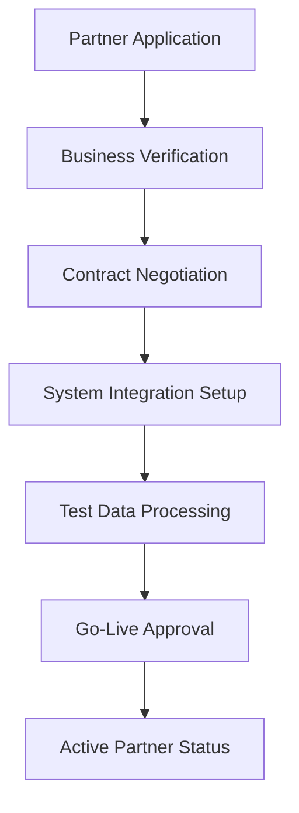

**Steps:**
1. **Application Submission:** Partner submits business documents and requirements
2. **Due Diligence:** Verify business license, financial stability, compliance status
3. **Contract Terms:** Negotiate commission rates, SLA requirements, data sharing agreements
4. **Technical Integration:** Setup data import/export formats, API connections
5. **Testing Phase:** Process sample debt portfolios, validate data accuracy
6. **Production Launch:** Activate partner for live debt collection operations

**Business Rules:**
- Partner must have valid financial services license
- Minimum debt portfolio size requirements
- Data format compliance mandatory
- SLA agreements must include response times and success rate targets

#### 1.2 Partner Data Import Process
```typescript
// Typical Partner Data Structure
interface PartnerDebtPortfolio {
  customers: CustomerData[];     // Debtor information
  contracts: ContractData[];     // Debt details
  transactions: TransactionData[]; // Payment history
  businessRules: {
    collectionStrategy: string;
    contactRestrictions: string[];
    legalEscalationRules: string;
  };
}
```

---

### 2. Customer & Contract Management Workflow

#### 2.1 Customer Data Processing
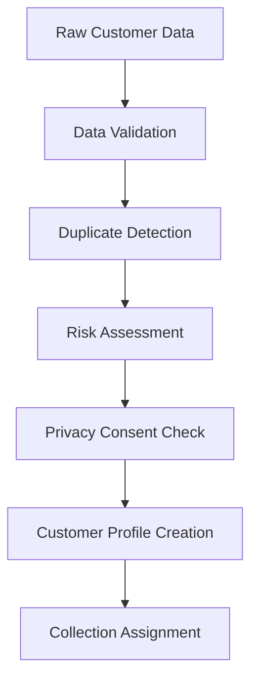

**Data Validation Rules:**
- **Identity Verification:** CCCD/CMND format validation
- **Contact Information:** Phone number format, email validation
- **Address Verification:** Complete address with postal code
- **Financial Information:** Income verification, employment status
- **Consent Status:** Data processing consent, marketing permissions

#### 2.2 Contract Assignment Strategy
```typescript
interface AssignmentCriteria {
  riskLevel: 'LOW' | 'MEDIUM' | 'HIGH' | 'CRITICAL';
  debtAmount: number;
  daysOverdue: number;
  customerProfile: {
    previousPaymentBehavior: string;
    contactResponsiveness: string;
    geographicLocation: string;
  };
  staffCapacity: {
    currentCaseload: number;
    specialization: string[];
    performanceRating: number;
  };
}
```

---

### 3. Collection Activity Workflows

#### 3.1 Early Collection Stage (0-30 days overdue)
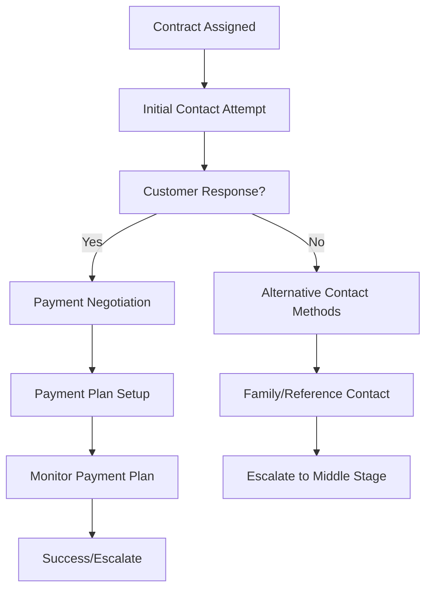

**Contact Strategy:**
1. **Day 1-3:** Soft reminder calls, SMS notifications
2. **Day 4-7:** Direct phone calls, email reminders
3. **Day 8-14:** Multiple contact attempts, alternative phone numbers
4. **Day 15-30:** Family contacts, workplace calls (if permitted)

#### 3.2 Middle Collection Stage (31-90 days overdue)
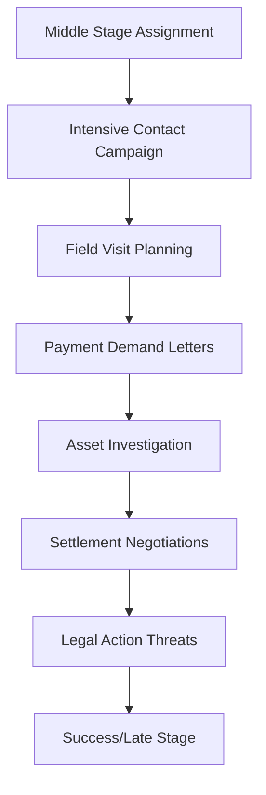

**Activities:**
- **Intensive Calling:** Daily contact attempts
- **Field Visits:** Home/workplace visits for serious cases
- **Investigation:** Asset discovery, employment verification
- **Negotiation:** Payment plans, settlement offers
- **Documentation:** Detailed activity records for legal preparation

#### 3.3 Late Collection Stage (90+ days overdue)
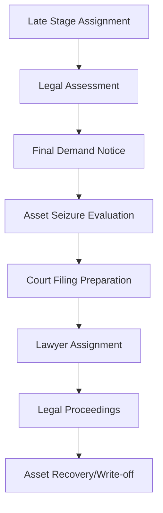

**Legal Actions:**
- **Demand Letters:** Official legal notices
- **Court Filings:** Debt recovery lawsuits
- **Asset Seizure:** Collateral recovery procedures
- **Bankruptcy Proceedings:** Creditor claims filing

---

### 4. Call Management Workflows

#### 4.1 Manual Call Process
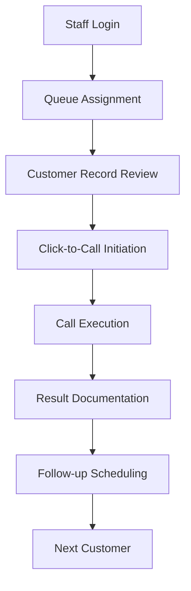

#### 4.2 Auto Dialer Workflow
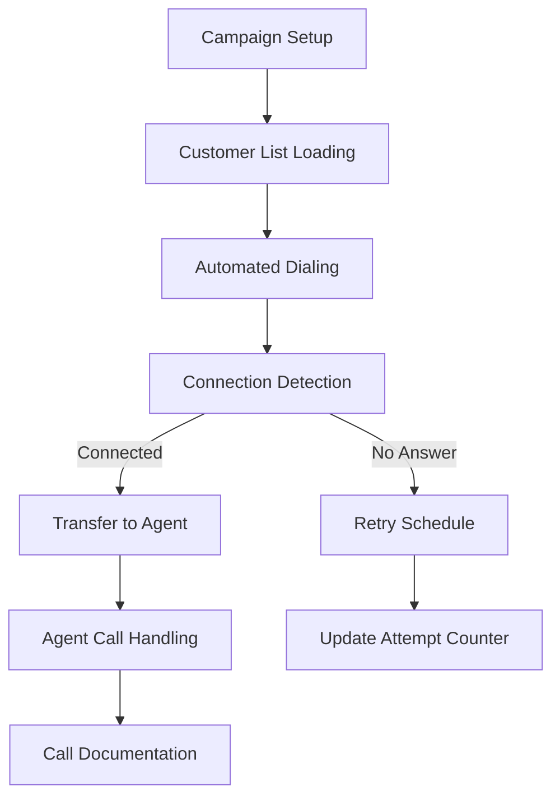

#### 4.3 Auto Call (ATC) System
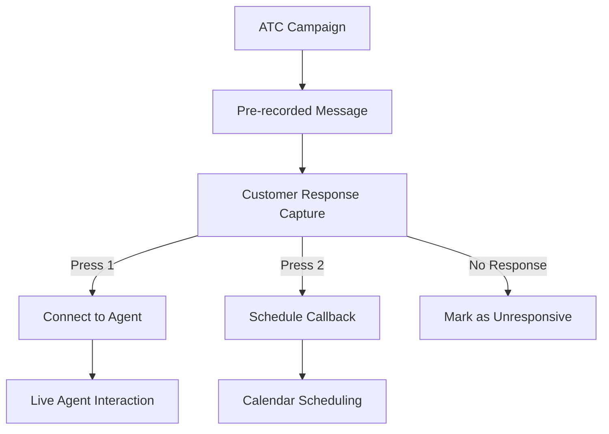

**Call Result Classification:**
```typescript
enum CallResult {
  CONNECTED = 'CONNECTED',           // Spoke with customer
  NO_ANSWER = 'NO_ANSWER',          // Phone rang but no answer
  BUSY = 'BUSY',                    // Line was busy
  INVALID_NUMBER = 'INVALID_NUMBER', // Number doesn't exist
  DECLINED = 'DECLINED',            // Customer hung up
  PROMISED_PAYMENT = 'PROMISED_PAYMENT', // Payment commitment made
  REFUSED_TO_PAY = 'REFUSED_TO_PAY', // Explicit refusal
  REQUEST_CALLBACK = 'REQUEST_CALLBACK', // Customer requested callback
}
```

---

### 5. Payment Processing Workflow

#### 5.1 Payment Receipt Process
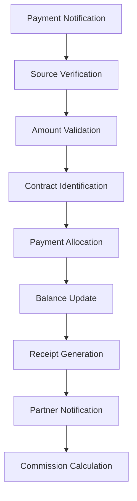

#### 5.2 Payment Allocation Rules
```typescript
interface PaymentAllocation {
  priority: [
    'PENALTY_FEES',      // Highest priority
    'INTEREST_CHARGES',  // Second priority
    'PRINCIPAL_AMOUNT'   // Remaining amount
  ];
  
  rules: {
    partialPayment: 'ALLOCATE_BY_PRIORITY';
    overpayment: 'CREDIT_BALANCE';
    multipleContracts: 'CUSTOMER_INSTRUCTION' | 'OLDEST_FIRST';
  };
}
```

#### 5.3 Payment Verification Workflow
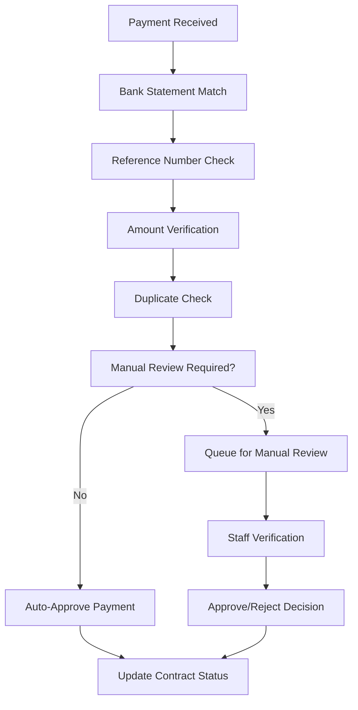

---

### 6. Performance Management Workflows

#### 6.1 Daily Performance Tracking
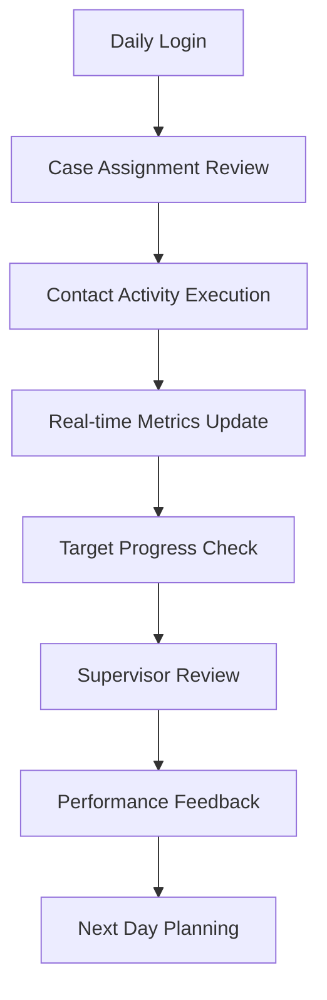

**KPI Tracking:**
```typescript
interface StaffPerformance {
  daily: {
    callsAttempted: number;
    contactsReached: number;
    paymentsSecured: number;
    amountCollected: number;
    hoursWorked: number;
  };
  monthly: {
    caseloadResolution: number;
    successRate: number;
    averageTimePerCase: number;
    customerSatisfactionScore: number;
  };
  targets: {
    monthlyCollectionTarget: number;
    contactRateTarget: number;
    resolutionTimeTarget: number;
  };
}
```

#### 6.2 Team Performance Management
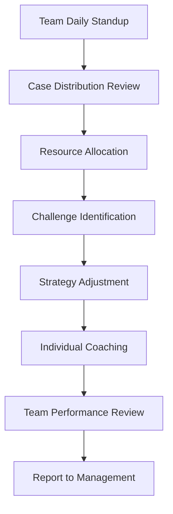

---

### 7. Reporting & Analytics Workflows

#### 7.1 Partner Performance Reporting
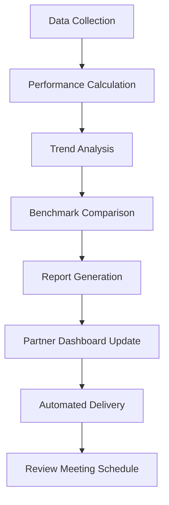

**Report Types:**
- **Collection Performance:** Success rates, resolution times, amount collected
- **Customer Contact Analytics:** Response rates, preferred contact methods
- **Staff Productivity:** Individual and team performance metrics
- **Financial Reconciliation:** Payment processing, commission calculations
- **Compliance Reports:** Regulatory requirement adherence, audit trails

#### 7.2 Business Intelligence Workflow
```typescript
interface BusinessIntelligence {
  portfolioAnalytics: {
    riskDistribution: RiskLevelAnalysis;
    ageingAnalysis: DebtAgeAnalysis;
    recoveryRates: RecoveryRateBySegment;
    customerBehaviorPatterns: BehaviorAnalysis;
  };
  
  operationalMetrics: {
    staffUtilization: UtilizationAnalysis;
    systemPerformance: SystemMetrics;
    costPerCollection: CostAnalysis;
    customerSatisfaction: SatisfactionMetrics;
  };
  
  predictiveAnalytics: {
    paymentProbability: ProbabilityScoring;
    resourceForecasting: ResourcePlanning;
    riskPrediction: RiskModeling;
  };
}
```

---

### 8. Compliance & Audit Workflows

#### 8.1 Data Privacy Compliance
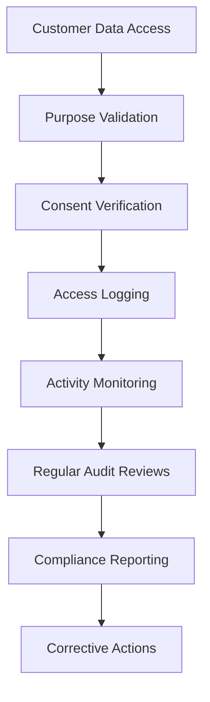

#### 8.2 Debt Collection Compliance
```typescript
interface ComplianceRules {
  contactRestrictions: {
    timeWindows: '8:00-20:00 weekdays, 9:00-17:00 weekends';
    frequencyLimits: 'max 3 calls per day, 10 per week';
    channelRestrictions: 'no workplace calls without permission';
    contentGuidelines: 'professional, respectful language only';
  };
  
  dataProtection: {
    encryptionRequired: boolean;
    accessControls: RoleBasedAccess;
    retentionPeriods: DataRetentionPolicy;
    auditTrails: AuditRequirements;
  };
  
  legalCompliance: {
    debtCollectionLaws: LocalRegulations;
    bankingSecrecy: BankingLawCompliance;
    consumerProtection: ConsumerRights;
  };
}
```

---

### 9. Exception Handling Workflows

#### 9.1 System Error Resolution
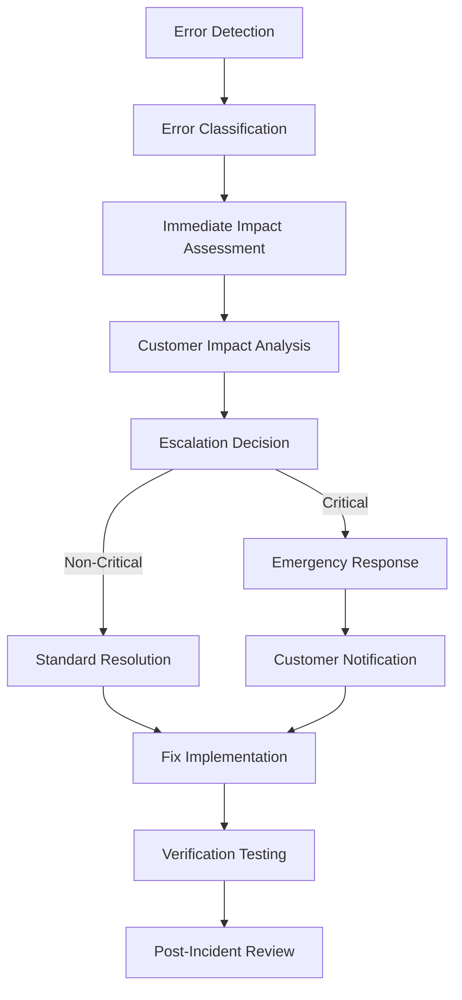

#### 9.2 Customer Complaint Handling
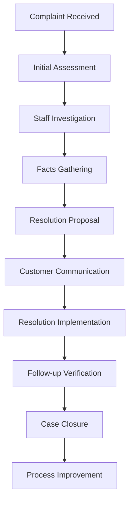

---

## 📊 SUCCESS METRICS

### Collection Performance
- **Recovery Rate:** Percentage of debt successfully collected
- **Resolution Time:** Average time from assignment to resolution
- **Contact Success Rate:** Percentage of successful customer contacts
- **Payment Compliance:** Customer adherence to agreed payment plans

### Operational Efficiency
- **Staff Productivity:** Cases resolved per staff member per month
- **System Uptime:** Availability of call systems and data processing
- **Cost Per Collection:** Total operational cost per dollar collected
- **Partner Satisfaction:** Partner feedback and retention rates

### Compliance Metrics
- **Data Privacy Compliance:** Zero data breaches, full consent tracking
- **Regulatory Adherence:** 100% compliance with debt collection laws
- **Audit Results:** Clean audit findings, timely corrective actions
- **Customer Satisfaction:** Respectful and professional interaction ratings

---

*Business Workflows Documentation for LCM Service*  
*Comprehensive Debt Collection Management Processes*  
*TranGPT LCM Service Development Team*